

  

  
  
  
  
  
  

  <a href="#onkonixai-nedir">Proje</a> ·
  <a href="#demo">Demo</a> ·
  <a href="#platform-mimarisi">Mimari</a> ·
  <a href="#bronkovision">BronkoVision</a> ·
  <a href="#eğitim-hattı">Eğitim Hattı</a>

 
Bir bronkoskopi görüntüsü yüklüyorsunuz. Sistem:
 
- **Görüntüde kanser olup olmadığını söylüyor** ve kararı verirken görüntünün hangi bölgesine baktığını ısı haritasıyla gösteriyor.
- **Tümörü piksel düzeyinde çiziyor**, ardından boyutunu, şeklini, rengini ve doku yapısını ölçüyor.
- **Tek bir 2B kareden tümörün 3B modelini oluşturuyor**, hacmini ve ne kadar düzensiz büyüdüğünü hesaplıyor.
- **Hiperspektral veriden hipoksiyle ilişkili (oksijensiz) bölgeleri haritalıyor.** Bu bölgeler tedaviye dirençle ilişkilendirilir.
Bunları yapan modül, OnkoNixAI'nin görüntü analiz motoru **BronkoVision**.
 
 
## OnkoNixAI nedir?
 
Akciğer kanseri, dünyada kansere bağlı ölümlerin başında gelir. Bir hastayla ilgili kritik bilgiler ise çoğu zaman birbirinden kopuk yerlerde durur: bronkoskopi görüntüleri bir sistemde, kan testleri ve sıvı biyopsi sonuçları başka bir sistemde, genetik profil ayrı bir raporda. Hekim bu parçaları zihninde birleştirmek zorunda kalır. Görüntülerin değerlendirmesi de büyük ölçüde göze dayanır ve kişiden kişiye değişir.
 
**OnkoNixAI bu parçaları bir araya getirir.** Görüntüleme, moleküler biyobelirteç ve klinik verileri birlikte analiz eden, hastaya özel tanı ve tedavi önerisi üreten **multimodal bir klinik karar destek platformudur.**
 
| | Geleneksel yaklaşım | OnkoNixAI |
|---|---|---|
| Görüntü değerlendirmesi | Görsel, sübjektif | Sayısal, tekrarlanabilir metrikler |
| Tümör morfolojisi | 2B gözlem | Otomatik segmentasyon + 3B model |
| Hipoksik bölgeler | Rutinde görülmez | Spektral analizle haritalanır |
| Biyobelirteçler | Tek tek, anlık değerler | Zaman içindeki değişimleriyle birlikte |
| Doz planı | Standart protokol | Hastaya özel optimizasyon |
| Model kararları | Kara kutu | Isı haritalarıyla açıklanabilir |
 
## Demo

<table>
  <tr>
    <td align="center" width="33%">
      <video src="https://github.com/user-attachments/assets/ffd47fe5-ed3d-424b-a122-c77422d6f9de" controls muted width="100%"></video>
    </td>
    <td align="center" width="33%">
      <video src="https://github.com/user-attachments/assets/d7eb0809-2093-488d-8358-d46282456422" controls muted width="100%"></video>
    </td>
    <td align="center" width="33%">
      <video src="https://github.com/user-attachments/assets/b432c627-cd99-4dee-8ca9-66f9584419f" controls muted width="100%"></video>
    </td>
  </tr>
  <tr>
    <td align="center"><b>BronkoVision</b> Görüntü analizi</td>
    <td align="center"><b>BiyoAnaliz</b> Biyobelirteç analizi</td>
    <td align="center"><b>DozOptimize</b> Doz optimizasyonu</td>
  </tr>
</table>

<i>Test ve tanıtım amaçlı ekran kaydıdır. Görüntülenen hasta bilgileri, değerler ve skorlar demo verisidir.</i> Videoları tam ekran izlemek için oynatıcıdaki tam ekran düğmesini kullanabilirsiniz.

## Platform mimarisi

 
OnkoNixAI, birbirini besleyen üç modülden oluşur:
 
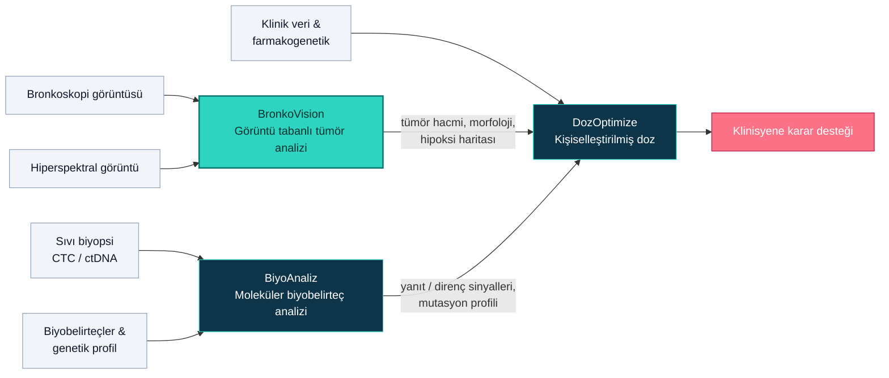
 
| Modül | Görev |
|---|---|
| **BronkoVision** | Bronkoskopi ve hiperspektral görüntülerden tümörü tespit eder, segmente eder, 3B modelini çıkarır ve hipoksi haritası üretir |
| **BiyoAnaliz** | CTC, ctDNA ve CEA, CYFRA 21-1, ProGRP, PD-L1 gibi biyobelirteçleri zaman içinde izler. Genetik mutasyon profilini (EGFR, ALK, ROS1, KRAS) ve immünoterapi yanıt potansiyelini değerlendirir |
| **DozOptimize** | Diğer iki modülün çıktılarını hastanın farmakogenetik profiliyle birleştirir. Etkinliği artıran, toksisiteyi azaltan kişisel doz önerileri üretir |
 
> [!NOTE]
> Platformda uçtan uca çalışan derin öğrenme hattı **BronkoVision**'dır. BiyoAnaliz ve DozOptimize ekranları, platformun bütününü göstermek için hazırlanmış arayüz prototipleridir; gösterilen analizler ve skorlar simüle edilmiş verilere dayanır.
 
Platform, **rol tabanlı bir web arayüzü** olarak çalışır. Kullanıcı rolü (*Doktor, Yönetici, Laboratuvar Uzmanı, Radyoloji Uzmanı*) ve hasta seçildiğinde role uygun sekmeler açılır: **Ana Ekran · Biyoanaliz · Görüntü Analizi · Doz Optimizasyonu · Tedavi Planı**.
 
 

  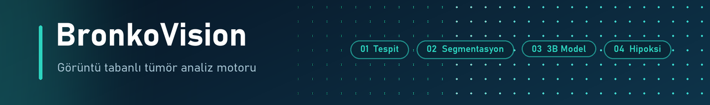

> [!NOTE]
> **Bu modülü ben geliştirdim.** Proje bir takım çalışması olduğu için kaynak kod ve model ağırlıkları paylaşılmamaktadır; bu sayfa modülün yaklaşımını ve sonuçlarını özetler.
 
 
BronkoVision, **dört derin öğrenme ve görüntü işleme aşamasını tek bir akışta** birleştirir. Bir bronkoskopi görüntüsü sırasıyla sınıflandırılır, segmente edilir ve 3B olarak modellenir. Hiperspektral veri yüklendiğinde, dördüncü aşamada bu veriden tümörün fonksiyonel (hipoksi) haritası çıkarılır. Klinisyen, tümörün **anatomik, morfolojik ve fonksiyonel** özelliklerini tek bir raporda görür.
 
<table>
  <tr>
    <td align="center" width="33%">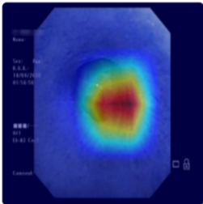</td>
    <td align="center" width="33%">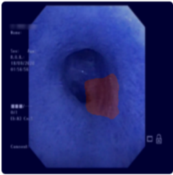</td>
    <td align="center" width="33%">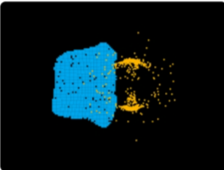</td>
  </tr>
  <tr>
    <td align="center"><b>Tespit</b> ResNet-152 + LayerCAM</td>
    <td align="center"><b>Segmentasyon</b> Attention U-Net</td>
    <td align="center"><b>3B Rekonstrüksiyon</b> PointNet Autoencoder</td>
  </tr>
</table>

  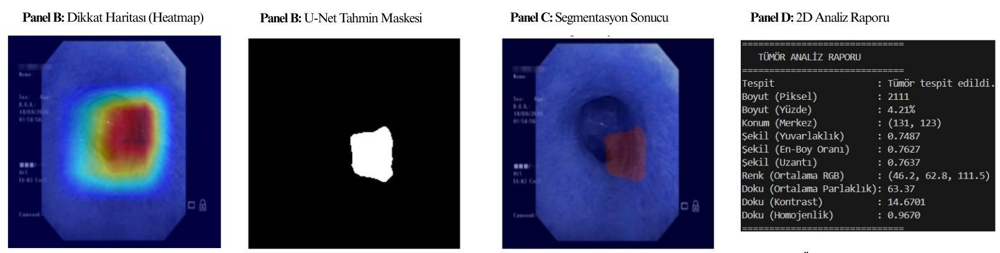
   Gerçek bir bronkoskopi karesi üzerinde uçtan uca akış: dikkat haritası → U-Net maskesi → segmentasyon bindirmesi → otomatik tümör raporu

### Pipeline
 

 
---
 
### 01 · ResNet-152 ile Kanser Tespiti
 
**Akıllı ön işleme.** Bronkoskopi görüntülerinin etrafında endoskop çerçevesinden kaynaklanan siyah alanlar bulunur. Görüntü yalnızca dokunun olduğu bölgeye kırpılır; böylece model çerçeveyi değil dokuyu öğrenir.
 
**Model.** ResNet-152 omurgası, ağı **lezyonun bulunduğu bölgeye odaklanmaya** zorlayan özgün bir özellik haritası maskeleme yaklaşımıyla kullanılır. Kenarlardaki yansımaların, yazıların ve çerçeve artefaktlarının karara etkisi azalır; aynı zamanda aşırı öğrenmeye karşı regülarizasyon etkisi sağlar.
 
**Açıklanabilirlik: LayerCAM.** Modelin dikkat haritası orijinal görüntünün üzerine bindirilir. Hekim yalnızca "kanser var" sonucunu değil, **modelin bu karara görüntünün hangi bölgesine bakarak vardığını** da görür.
 
### 02 · Attention U-Net ile Segmentasyon ve Kantitatif Analiz
 
**Mimari.** Attention U-Net, her skip bağlantısındaki **dikkat kapıları (attention gate)** ile ilgisiz arka planı bastırırken **tümör sınırlarını ve dokusal detayları** öne çıkarır ve piksel düzeyinde ikili tümör maskesi üretir.
 
**Kantitatif tümör profili.** Maske üzerinden tümörü tanımlayan bir dizi metrik hesaplanır:
 
| Kategori | Metrikler | Ne anlatır? |
|---|---|---|
| Boyut | Alan, görüntüye oranı | Lezyonun büyüklüğü |
| Konum | Ağırlık merkezi | Lezyonun yeri |
| Şekil | Dairesellik, en-boy oranı, uzantı | Sınır düzensizliği, uzama, girintililik |
| Renk | Ortalama renk | Lezyon dokusunun rengi |
| Doku | Parlaklık, doku kontrastı ve homojenliği | Yoğunluk ve doku heterojenliği |
 
Düzensiz sınırlar ve heterojen doku, klinikte malignite ve invazivlikle ilişkilendirilen bulgulardır. BronkoVision bu bulguları **sayılara dönüştürür.**
 
### 03 · Tek Bir 2B Görüntüden 3B Tümör Modeli
 
Tümör maskesi, tümörün kubbe biçimli 3B yüzeyini temsil eden bir **nokta bulutuna** dönüştürülür. **PointNet Autoencoder** bu buluttan nokta sırasından bağımsız bir şekil temsili öğrenir ve girdideki düzensiz noktalara göre **daha düzgün ve tutarlı** bir 3B tümör yüzeyi oluşturur. Yeniden oluşturulan model üzerinden 3B morfolojik metrikler hesaplanır (değerler göreceli birimdedir):
 
| Metrik | Anlamı |
|---|---|
| Hacim | Tümörün 3B büyüklüğü |
| Yüzey alanı | Çevre dokuyla temas yüzeyi |
| **Küresellik** | 1 = mükemmel küre. Küresellikten sapma, **düzensiz büyümenin ve olası invazivliğin** göstergesi olarak kullanılır |
 
### 04 · Hiperspektral Görüntüleme ile Hipoksi Haritası
 
> [!IMPORTANT]
> Tümörün oksijen almayan (hipoksik) bölgeleri, **radyoterapi ve kemoterapiye karşı dirençle** ilişkilendirilir. Bu bölgeleri tedavi öncesinde görmek, doz artırımı veya hipoksiye yönelik ilaç seçimi gibi kararlar için kritik bilgi sağlar.
 
Oksijenli (HbO₂) ve oksijensiz (Hb) hemoglobin ışığı farklı dalga boylarında farklı soğurur. Bu yüzden her dokunun bir **spektral parmak izi** vardır. BronkoVision bu parmak izini okur.
 
Tümörlü ve sağlıklı dokudan **referans spektral imzalar** çıkarılır, ardından tümör dokusundaki **her pikselin spektrumu** hipoksik referansla karşılaştırılır. Karşılaştırma spektrumun genliğine değil **şekline** baktığı için genel aydınlatma şiddetindeki farklardan etkilenmez. Sonuç, sözde-RGB görüntünün üzerine **renkli bir hipoksi haritası** olarak bindirilir.
 
Ham hiperspektral veriler kalibre edilip sıkıştırılarak web arayüzünde hızlı çalışacak hale getirilir.
 

  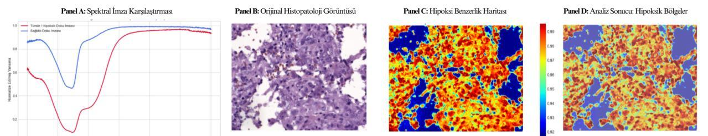
   Tümörlü (kırmızı) ve sağlıklı (mavi) dokunun spektral imzaları ~550–580 nm'deki hemoglobin soğurma bölgesinde ayrışıyor · H&E görüntüsü · piksel bazlı hipoksi benzerlik haritası · hipoksik bölgelerin dokuya bindirilmiş hali

Hemoglobin oksijenlenmesinin spektral prensibi doku tipinden büyük ölçüde bağımsız olduğu için yöntem farklı dokulara uyarlanabilir. Konsept kanıtlaması, etiketli hiperspektral **tümör histopatolojisi** görüntüleri üzerinde yapılmıştır.
 
## Eğitim hattı
 
Üç model, birbirini besleyen tek bir hatta eğitildi.
 
> [!TIP]
> Eğitimde **yalnızca görüntü düzeyinde etiket** (kanser / kanser değil) kullanıldı. **Piksel düzeyinde hiçbir maske elle çizilmedi.** Segmentasyon ve 3B modeller, sınıflandırıcının dikkat haritalarından türetilen verilerle öğrendi.
 
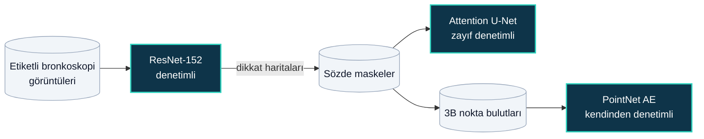
 
- **ResNet → U-Net:** Eğitilmiş sınıflandırıcının dikkat haritaları **sözde maskelere** dönüştürülür. U-Net bu sözde maskeleri hedef alarak görüntüden doğrudan, tam çözünürlükte tümör maskesi üretmeyi öğrenir (*pseudo-labeling*).
- **Sözde maskeler → PointNet:** Aynı maskeler 3B nokta bulutlarına çevrilir. Autoencoder, girdisini yeniden üreterek tümör şekillerinin bir temsilini öğrenir; bu aşamada da etiket gerekmez.
<table>
  <tr>
    <td align="center" width="50%">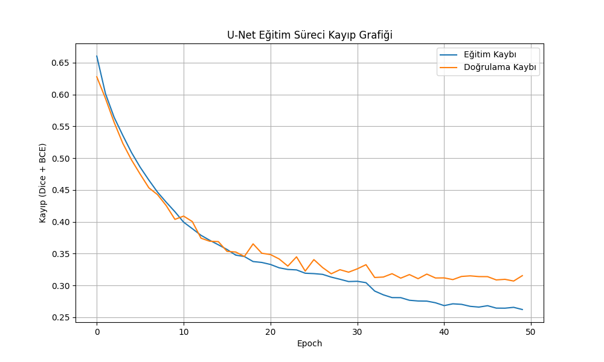</td>
    <td align="center" width="50%">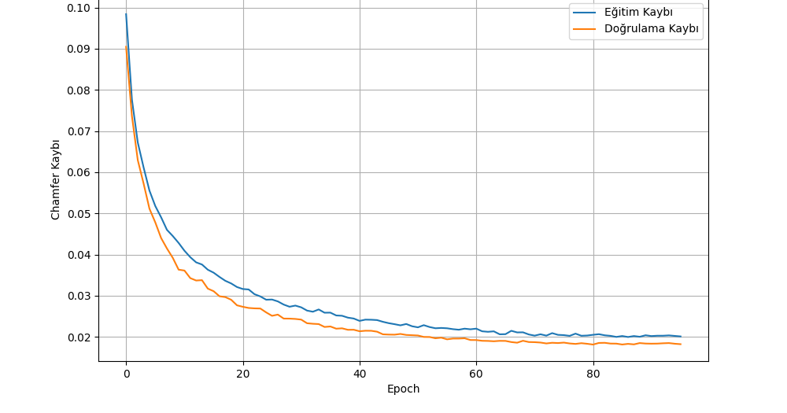</td>
  </tr>
  <tr>
    <td align="center">Attention U-Net · Dice + BCE kaybı</td>
    <td align="center">PointNet Autoencoder · Chamfer kaybı</td>
  </tr>
</table>
### Arayüz
 
**Görüntü Analizi** sekmesinde bronkoskopi görüntüsü ve isteğe bağlı olarak hiperspektral veri yüklenir. Tek tıkla tüm aşamalar sırayla çalışır ve **Bütüncül Analiz Raporu** her aşamayı ayrı panelde gösterir.
 
## Teknolojiler
 
| Alan | Araçlar |
|---|---|
| Derin öğrenme | PyTorch, torchvision, pytorch-grad-cam |
| Görüntü işleme | OpenCV, scikit-image, Pillow, spectral |
| 3B analiz | Open3D, SciPy |
| Arayüz & görselleştirme | Streamlit, Plotly, Matplotlib |
| Veri | pandas |
 
> [!CAUTION]
> OnkoNixAI bir araştırma projesidir ve klinik kullanım için onaylanmış bir tıbbi cihaz değildir. Çıktıları tanı veya tedavi kararının yerine geçmez.
 

  

  
  
  
  
  
  

  <a href="#onkonixai-nedir">Proje</a> ·
  <a href="#demo">Demo</a> ·
  <a href="#platform-mimarisi">Mimari</a> ·
  <a href="#bronkovision">BronkoVision</a> ·
  <a href="#eğitim-hattı">Eğitim Hattı</a>

 
Bir bronkoskopi görüntüsü yüklüyorsunuz. Sistem:
 
- **Görüntüde kanser olup olmadığını söylüyor** ve kararı verirken görüntünün hangi bölgesine baktığını ısı haritasıyla gösteriyor.
- **Tümörü piksel düzeyinde çiziyor**, ardından boyutunu, şeklini, rengini ve doku yapısını ölçüyor.
- **Tek bir 2B kareden tümörün 3B modelini oluşturuyor**, hacmini ve ne kadar düzensiz büyüdüğünü hesaplıyor.
- **Hiperspektral veriden hipoksiyle ilişkili (oksijensiz) bölgeleri haritalıyor.** Bu bölgeler tedaviye dirençle ilişkilendirilir.
Bunları yapan modül, OnkoNixAI'nin görüntü analiz motoru **BronkoVision**.
 
 
## OnkoNixAI nedir?
 
Akciğer kanseri, dünyada kansere bağlı ölümlerin başında gelir. Bir hastayla ilgili kritik bilgiler ise çoğu zaman birbirinden kopuk yerlerde durur: bronkoskopi görüntüleri bir sistemde, kan testleri ve sıvı biyopsi sonuçları başka bir sistemde, genetik profil ayrı bir raporda. Hekim bu parçaları zihninde birleştirmek zorunda kalır. Görüntülerin değerlendirmesi de büyük ölçüde göze dayanır ve kişiden kişiye değişir.
 
**OnkoNixAI bu parçaları bir araya getirir.** Görüntüleme, moleküler biyobelirteç ve klinik verileri birlikte analiz eden, hastaya özel tanı ve tedavi önerisi üreten **multimodal bir klinik karar destek platformudur.**
 
| | Geleneksel yaklaşım | OnkoNixAI |
|---|---|---|
| Görüntü değerlendirmesi | Görsel, sübjektif | Sayısal, tekrarlanabilir metrikler |
| Tümör morfolojisi | 2B gözlem | Otomatik segmentasyon + 3B model |
| Hipoksik bölgeler | Rutinde görülmez | Spektral analizle haritalanır |
| Biyobelirteçler | Tek tek, anlık değerler | Zaman içindeki değişimleriyle birlikte |
| Doz planı | Standart protokol | Hastaya özel optimizasyon |
| Model kararları | Kara kutu | Isı haritalarıyla açıklanabilir |
 
## Demo
 
<!--
  Videoları eklemek için: GitHub'da README'yi düzenlerken her mp4 dosyasını editöre sürükleyip bırakın.
  GitHub'ın ürettiği https://github.com/user-attachments/assets/... bağlantısını kopyalayıp
  aşağıdaki ilgili src="..." değerinin yerine yapıştırın, ardından editörde kalan bağlantı satırını silin.
-->
 
<table>
  <tr>
    <td align="center" width="33%">
      <video src="https://github.com/user-attachments/assets/b846c145-b82f-4eb7-be34-af986dcf788a" controls muted width="100%"></video>
    </td>
    <td align="center" width="33%">
      <video src="https://github.com/user-attachments/assets/c22aa253-7d08-42b8-a67b-59c5ad452512" controls muted width="100%"></video>
    </td>
    <td align="center" width="33%">
      <video src="https://github.com/user-attachments/assets/0a99c729-17f3-4894-8e39-8f0aaf55678b" controls muted width="100%"></video>
    </td>
  </tr>
 
 
  <tr>
    <td align="center"><b>BronkoVision</b> Görüntü analizi</td>
    <td align="center"><b>BiyoAnaliz</b> Biyobelirteç analizi</td>
    <td align="center"><b>DozOptimize</b> Doz optimizasyonu</td>
  </tr>
</table>

<i>Test ve tanıtım amaçlı ekran kaydıdır. Görüntülenen hasta bilgileri, değerler ve skorlar demo verisidir.</i> Videoları tam ekran izlemek için oynatıcıdaki tam ekran düğmesini kullanabilirsiniz.

## Platform mimarisi
 
OnkoNixAI, birbirini besleyen üç modülden oluşur:
 

 
| Modül | Görev |
|---|---|
| **BronkoVision** | Bronkoskopi ve hiperspektral görüntülerden tümörü tespit eder, segmente eder, 3B modelini çıkarır ve hipoksi haritası üretir |
| **BiyoAnaliz** | CTC, ctDNA ve CEA, CYFRA 21-1, ProGRP, PD-L1 gibi biyobelirteçleri zaman içinde izler. Genetik mutasyon profilini (EGFR, ALK, ROS1, KRAS) ve immünoterapi yanıt potansiyelini değerlendirir |
| **DozOptimize** | Diğer iki modülün çıktılarını hastanın farmakogenetik profiliyle birleştirir. Etkinliği artıran, toksisiteyi azaltan kişisel doz önerileri üretir |
 
> [!NOTE]
> Platformda uçtan uca çalışan derin öğrenme hattı **BronkoVision**'dır. BiyoAnaliz ve DozOptimize ekranları, platformun bütününü göstermek için hazırlanmış arayüz prototipleridir; gösterilen analizler ve skorlar simüle edilmiş verilere dayanır.
 
Platform, **rol tabanlı bir web arayüzü** olarak çalışır. Kullanıcı rolü (*Doktor, Yönetici, Laboratuvar Uzmanı, Radyoloji Uzmanı*) ve hasta seçildiğinde role uygun sekmeler açılır: **Ana Ekran · Biyoanaliz · Görüntü Analizi · Doz Optimizasyonu · Tedavi Planı**.
 
 

  

> [!NOTE]
> **Bu modülü ben geliştirdim.** Proje bir takım çalışması olduğu için kaynak kod ve model ağırlıkları paylaşılmamaktadır; bu sayfa modülün yaklaşımını ve sonuçlarını özetler.
 
 
BronkoVision, **dört derin öğrenme ve görüntü işleme aşamasını tek bir akışta** birleştirir. Bir bronkoskopi görüntüsü sırasıyla sınıflandırılır, segmente edilir ve 3B olarak modellenir. Hiperspektral veri yüklendiğinde, dördüncü aşamada bu veriden tümörün fonksiyonel (hipoksi) haritası çıkarılır. Klinisyen, tümörün **anatomik, morfolojik ve fonksiyonel** özelliklerini tek bir raporda görür.
 
<table>
  <tr>
    <td align="center" width="33%"></td>
    <td align="center" width="33%"></td>
    <td align="center" width="33%"></td>
  </tr>
  <tr>
    <td align="center"><b>Tespit</b> ResNet-152 + LayerCAM</td>
    <td align="center"><b>Segmentasyon</b> Attention U-Net</td>
    <td align="center"><b>3B Rekonstrüksiyon</b> PointNet Autoencoder</td>
  </tr>
</table>

  
   Gerçek bir bronkoskopi karesi üzerinde uçtan uca akış: dikkat haritası → U-Net maskesi → segmentasyon bindirmesi → otomatik tümör raporu

### Pipeline
 
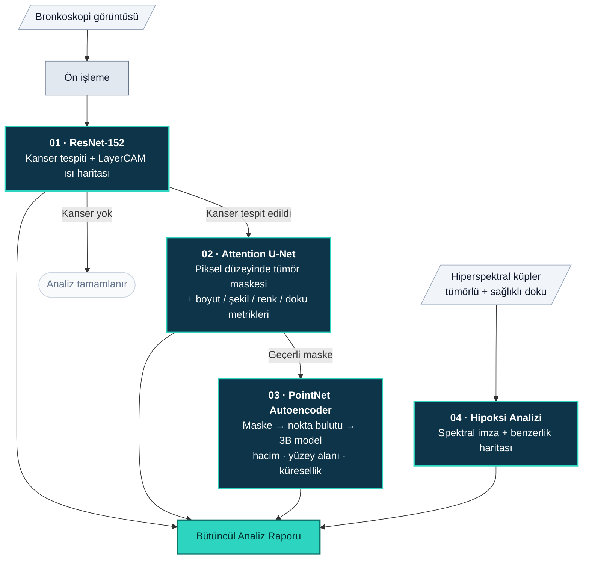
 
---
 
### 01 · ResNet-152 ile Kanser Tespiti
 
**Akıllı ön işleme.** Bronkoskopi görüntülerinin etrafında endoskop çerçevesinden kaynaklanan siyah alanlar bulunur. Görüntü yalnızca dokunun olduğu bölgeye kırpılır; böylece model çerçeveyi değil dokuyu öğrenir.
 
**Model.** ResNet-152 omurgası, ağı **lezyonun bulunduğu bölgeye odaklanmaya** zorlayan özgün bir özellik haritası maskeleme yaklaşımıyla kullanılır. Kenarlardaki yansımaların, yazıların ve çerçeve artefaktlarının karara etkisi azalır; aynı zamanda aşırı öğrenmeye karşı regülarizasyon etkisi sağlar.
 
**Açıklanabilirlik: LayerCAM.** Modelin dikkat haritası orijinal görüntünün üzerine bindirilir. Hekim yalnızca "kanser var" sonucunu değil, **modelin bu karara görüntünün hangi bölgesine bakarak vardığını** da görür.
 
### 02 · Attention U-Net ile Segmentasyon ve Kantitatif Analiz
 
**Mimari.** Attention U-Net, her skip bağlantısındaki **dikkat kapıları (attention gate)** ile ilgisiz arka planı bastırırken **tümör sınırlarını ve dokusal detayları** öne çıkarır ve piksel düzeyinde ikili tümör maskesi üretir.
 
**Kantitatif tümör profili.** Maske üzerinden tümörü tanımlayan bir dizi metrik hesaplanır:
 
| Kategori | Metrikler | Ne anlatır? |
|---|---|---|
| Boyut | Alan, görüntüye oranı | Lezyonun büyüklüğü |
| Konum | Ağırlık merkezi | Lezyonun yeri |
| Şekil | Dairesellik, en-boy oranı, uzantı | Sınır düzensizliği, uzama, girintililik |
| Renk | Ortalama renk | Lezyon dokusunun rengi |
| Doku | Parlaklık, doku kontrastı ve homojenliği | Yoğunluk ve doku heterojenliği |
 
Düzensiz sınırlar ve heterojen doku, klinikte malignite ve invazivlikle ilişkilendirilen bulgulardır. BronkoVision bu bulguları **sayılara dönüştürür.**
 
### 03 · Tek Bir 2B Görüntüden 3B Tümör Modeli
 
Tümör maskesi, tümörün kubbe biçimli 3B yüzeyini temsil eden bir **nokta bulutuna** dönüştürülür. **PointNet Autoencoder** bu buluttan nokta sırasından bağımsız bir şekil temsili öğrenir ve girdideki düzensiz noktalara göre **daha düzgün ve tutarlı** bir 3B tümör yüzeyi oluşturur. Yeniden oluşturulan model üzerinden 3B morfolojik metrikler hesaplanır (değerler göreceli birimdedir):
 
| Metrik | Anlamı |
|---|---|
| Hacim | Tümörün 3B büyüklüğü |
| Yüzey alanı | Çevre dokuyla temas yüzeyi |
| **Küresellik** | 1 = mükemmel küre. Küresellikten sapma, **düzensiz büyümenin ve olası invazivliğin** göstergesi olarak kullanılır |
 
### 04 · Hiperspektral Görüntüleme ile Hipoksi Haritası
 
> [!IMPORTANT]
> Tümörün oksijen almayan (hipoksik) bölgeleri, **radyoterapi ve kemoterapiye karşı dirençle** ilişkilendirilir. Bu bölgeleri tedavi öncesinde görmek, doz artırımı veya hipoksiye yönelik ilaç seçimi gibi kararlar için kritik bilgi sağlar.
 
Oksijenli (HbO₂) ve oksijensiz (Hb) hemoglobin ışığı farklı dalga boylarında farklı soğurur. Bu yüzden her dokunun bir **spektral parmak izi** vardır. BronkoVision bu parmak izini okur.
 
Tümörlü ve sağlıklı dokudan **referans spektral imzalar** çıkarılır, ardından tümör dokusundaki **her pikselin spektrumu** hipoksik referansla karşılaştırılır. Karşılaştırma spektrumun genliğine değil **şekline** baktığı için genel aydınlatma şiddetindeki farklardan etkilenmez. Sonuç, sözde-RGB görüntünün üzerine **renkli bir hipoksi haritası** olarak bindirilir.
 
Ham hiperspektral veriler kalibre edilip sıkıştırılarak web arayüzünde hızlı çalışacak hale getirilir.
 

  
   Tümörlü (kırmızı) ve sağlıklı (mavi) dokunun spektral imzaları ~550–580 nm'deki hemoglobin soğurma bölgesinde ayrışıyor · H&E görüntüsü · piksel bazlı hipoksi benzerlik haritası · hipoksik bölgelerin dokuya bindirilmiş hali

Hemoglobin oksijenlenmesinin spektral prensibi doku tipinden büyük ölçüde bağımsız olduğu için yöntem farklı dokulara uyarlanabilir. Konsept kanıtlaması, etiketli hiperspektral **tümör histopatolojisi** görüntüleri üzerinde yapılmıştır.
 
## Eğitim hattı
 
Üç model, birbirini besleyen tek bir hatta eğitildi.
 
> [!TIP]
> Eğitimde **yalnızca görüntü düzeyinde etiket** (kanser / kanser değil) kullanıldı. **Piksel düzeyinde hiçbir maske elle çizilmedi.** Segmentasyon ve 3B modeller, sınıflandırıcının dikkat haritalarından türetilen verilerle öğrendi.
 

 
- **ResNet → U-Net:** Eğitilmiş sınıflandırıcının dikkat haritaları **sözde maskelere** dönüştürülür. U-Net bu sözde maskeleri hedef alarak görüntüden doğrudan, tam çözünürlükte tümör maskesi üretmeyi öğrenir (*pseudo-labeling*).
- **Sözde maskeler → PointNet:** Aynı maskeler 3B nokta bulutlarına çevrilir. Autoencoder, girdisini yeniden üreterek tümör şekillerinin bir temsilini öğrenir; bu aşamada da etiket gerekmez.
<table>
  <tr>
    <td align="center" width="50%"></td>
    <td align="center" width="50%"></td>
  </tr>
  <tr>
    <td align="center">Attention U-Net · Dice + BCE kaybı</td>
    <td align="center">PointNet Autoencoder · Chamfer kaybı</td>
  </tr>
</table>
### Arayüz
 
**Görüntü Analizi** sekmesinde bronkoskopi görüntüsü ve isteğe bağlı olarak hiperspektral veri yüklenir. Tek tıkla tüm aşamalar sırayla çalışır ve **Bütüncül Analiz Raporu** her aşamayı ayrı panelde gösterir.
 
## Teknolojiler
 
| Alan | Araçlar |
|---|---|
| Derin öğrenme | PyTorch, torchvision, pytorch-grad-cam |
| Görüntü işleme | OpenCV, scikit-image, Pillow, spectral |
| 3B analiz | Open3D, SciPy |
| Arayüz & görselleştirme | Streamlit, Plotly, Matplotlib |
| Veri | pandas |
 
> [!CAUTION]
> OnkoNixAI bir araştırma projesidir ve klinik kullanım için onaylanmış bir tıbbi cihaz değildir. Çıktıları tanı veya tedavi kararının yerine geçmez.
 
